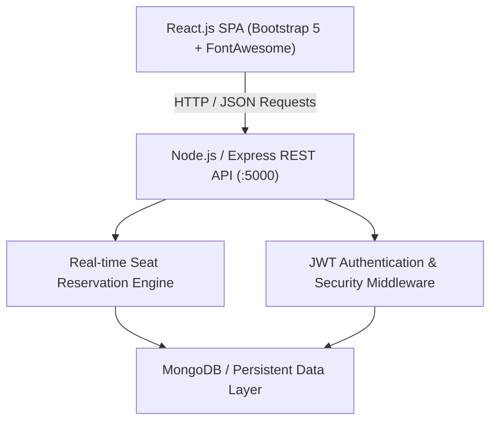

# 🎬 IMovies - Movie Ticket Booking Made Simple

[](https://reactjs.org/)
[](https://nodejs.org/)
[](https://expressjs.com/)
[](https://www.mongodb.com/)
[-orange.svg)](https://jwt.io/)
[](https://getbootstrap.com/)

> **Project Brief**: IMovies is a seamless online platform that enhances the cinema experience by allowing users to browse movies, select showtimes, and reserve seats with real-time availability tracking. Built with Express.js and MongoDB architecture, it leverages a robust client-server design to ensure efficient data management and smooth performance.

---

## 📌 Project Links for Mentor Evaluation
- **Localhost Development URL**: `http://localhost:5000`
- **GitHub Repository**: [Update with your repository URL]
- **Live Demo Link**: [Update with your deployed link]

---

## 🌟 Key Features

1. **Interactive Real-Time Auditorium Seat Map**:
   - 96-seat responsive layout featuring **Silver**, **Gold**, and **Platinum Recliner** tiers.
   - Curved cinema screen with real-time seat availability (`Available`, `Selected`, `Booked`).
   - Dynamic collision prevention ensuring no double-booking occurs.

2. **Movie Catalog & Intelligent Discovery**:
   - Filter by **Now Showing** and **Upcoming Releases**.
   - Genre filter pills (Action, Sci-Fi, Drama, Animation, Adventure).
   - Real-time multi-attribute search (by movie title, director, or cast).
   - Rich movie details modal with certificates, IMDb-style ratings, synopsis, and cast lists.

3. **Secure User Authentication (JWT)**:
   - JSON Web Token (HS256) session management.
   - User Registration and Login with SHA-256 hashed password security.
   - Protected routes and persistent authentication state in localStorage.
   - Pre-configured Demo Account: `demo@imovies.com` / `password123`.

4. **Booking Management & Digital Pass**:
   - Automated ticket pricing engine calculating subtotal, 8% convenience fees, and total payable.
   - Instant digital ticket generation with unique Reference ID (e.g. `BK-94821`) and QR Code simulation.
   - **My Bookings Dashboard**: View all past/current tickets.
   - One-click ticket cancellation with dynamic seat inventory release.

5. **Mentor Evaluation & Kanban Board**:
   - In-app **Epics & Kanban** tracker displaying 100% completion across all 6 Epics and 19 Tasks.

---

## 🏗️ System Architecture



---

## 📊 Project Epics & Tasks Breakdown (6 Epics, 19 Tasks)

| Epic | Tasks Count | Scope & Deliverables | Status |
| :--- | :---: | :--- | :---: |
| **Epic 1: Architecture & System Setup** | 3 | Scaffolding, Express REST routing, data models | ✅ Completed |
| **Epic 2: User Authentication & Security** | 3 | JWT token generation, SHA-256 hashing, session state | ✅ Completed |
| **Epic 3: Movie Catalog & Discovery** | 4 | Database seeding, search & genre filter, movie details | ✅ Completed |
| **Epic 4: Showtimes & Theaters** | 3 | Multiplex formats (IMAX, Atmos, 4DX), multi-tier pricing | ✅ Completed |
| **Epic 5: Real-time Seat Engine** | 3 | Interactive 96-seat map, conflict prevention, fee engine | ✅ Completed |
| **Epic 6: Booking Management** | 3 | Digital ticket pass with QR, My Bookings, seat release | ✅ Completed |

---

## 📡 REST API Reference

| Method | Endpoint | Description | Protected |
| :--- | :--- | :--- | :---: |
| `GET` | `/api/movies` | Fetch all movies (supports `?search=`, `?genre=`, `?status=`) | No |
| `GET` | `/api/movies/:id` | Get movie details with enriched showtimes & theater info | No |
| `GET` | `/api/theaters` | List all theaters and screen capabilities | No |
| `GET` | `/api/showtimes` | Query showtimes by date and movie | No |
| `GET` | `/api/showtimes/:id` | Get showtime seat layout and booked seats map | No |
| `POST` | `/api/auth/register` | Register new user account | No |
| `POST` | `/api/auth/login` | Authenticate user & issue JWT token | No |
| `GET` | `/api/auth/me` | Fetch authenticated user profile | Yes (JWT) |
| `POST` | `/api/bookings` | Reserve seats and generate booking pass | Optional |
| `GET` | `/api/bookings/my` | Retrieve bookings for current user | Optional |
| `DELETE` | `/api/bookings/:id` | Cancel booking and release seats back to inventory | Optional |
| `GET` | `/api/stats` | Project stats, epics completion, and system health | No |

---

## 💻 System Prerequisites & Setup

### Requirements
- **Operating System**: Windows 10/11, macOS, or Linux
- **Node.js**: v16.0.0 or higher
- **Browser**: Chrome, Firefox, Edge (modern evergreen browser)

### Quick Start Instructions
1. Clone or navigate to the project directory:
   ```bash
   cd imovies
   ```
2. Run the application:
   ```bash
   node server.js
   ```
   *(Or double-click `start.bat` on Windows)*
3. Open your browser and visit:
   ```
   http://localhost:5000
   ```
